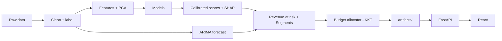

# Customer Churn & Revenue Risk Platform

From raw data to a calibrated churn model, revenue at risk, a segment-aware retention budget, a FastAPI backend and a React dashboard.

  


## Problem

Customers who churn are cheaper to keep than to replace, but retention budgets are finite. Reacting after a customer leaves is too late. Flagging every customer who looks risky wastes money on those who would have stayed. The goal is to find who is likely to leave, estimate how much revenue that puts at risk, and spend a fixed budget where it saves the most.

## The two claims

1. **Calibration matters more than ranking when churn scores drive spending.** A model with high AUC but miscalibrated probabilities misallocates budget.
2. **Segment-aware allocation beats uniform discounting at equal budget.**

Both are tested in Step 8 on the held-out test split, scored with true labels where that matters (`reports/allocation.md`, `make claims`). Verdicts, from the numbers:

- **Claim 1: not supported by this data.** Six probability sources (RF raw / isotonic / Platt, a deliberately miscalibrated RF+SMOTE, Naive Bayes, XGBoost) each drive the same allocator; realized saved revenue uses the actual churn labels. Paired bootstrap CIs against RF raw all contain zero. ECE and Brier rank-correlate with realized savings more than PR-AUC does (Spearman -0.89 / -0.94 vs +0.64) but n = 6 and Brier also contains ranking quality, so this is suggestive only. A structural reason: with a binding budget, rescaling all probabilities is absorbed by the Lagrange multiplier, so only distortions that reorder customers matter.
- **Claim 2: true against uniform, weaker against the fair baseline.** Segment-aware KKT saves about 5x uniform at equal budget. Against `global_kkt` (same solver, one global response curve) it saves +16.8% in expected terms, but that is partly by construction because the evaluation model contains the segment parameters; with true labels the realized difference is +12k with a 90% CI of [-10k, +35k], and after offer snapping the expected margin shrinks to about 6%, level with simple `top_k_risk`. The lead survives all 204 +-25/50% perturbations of the response parameters but disappears if the assumed tier effect is reversed. The response curves are assumptions, not measured uplift.

## Architecture



## Pipeline

| # | Step | What it involves | Depends on | Output | Owner | Status |
|---|---|---|---|---|---|---|
| 1 | Setup + dataset | Repo, config, Makefile. Dataset chosen against hard rules (real churn labels, timestamps, revenue per customer, behavioural features, ≥10k customers). Data contracts agreed. | none | repo, dataset choice, contracts | TBD | ✅ |
| 2 | Data + EDA | Ingestion + schema checks, monthly snapshot labeling, cleaning (imputation, outlier capping, Box-Cox/Yeo-Johnson). EDA: churn by tier and over time, correlation + VIF, engagement × support co-occurrence test. | 1 | clean labeled data, EDA report | TBD | ✅ |
| 3 | Features + PCA + imbalance | Recency, tenure, usage trend slope, payment and revenue features. Time-based split + expanding-window CV. PCA with interpreted loadings. Class weights vs SMOTE vs undersampling. | 2 | feature matrix, PCA, split | TBD | ✅ |
| 4 | Modeling + calibration + SHAP | Logistic regression MLE vs MAP, Naive Bayes, Random Forest, XGBoost, LSTM. PR-AUC, Brier, ECE. Platt/isotonic calibration, cost-based threshold, SHAP top 5 drivers, model card. | 3 | `scores.parquet`, model | TBD | ✅ |
| 5 | Revenue risk + forecast + segments | Revenue at risk = P(churn) × customer value. ARIMA vs moving-average baseline. GMM segments chosen by BIC, crossed with value tiers. | 4 (ARIMA needs only 2) | forecast, segments | TBD | ✅ |
| 6 | Budget allocation | Lagrangian/KKT solver + gradient-descent check, offer matching per segment, reallocation loop. Strategy comparison, sensitivity analysis, calibrated vs uncalibrated test. | 4, 5 (solver can use mock data) | `allocations.parquet`, allocation report | TBD | ✅ |
| 7 | App + ship | FastAPI endpoints + React dashboard (Overview, Client Lookup, Budget Planner, Model & Data). Tests + CI, Docker, deploy, final report. | 6 (can start on mock data after 1) | live app, docs | TBD | ✅ |
| 8 | Make the claims testable | Segment-aware response curves per segment x value tier, offer catalog and two-stage matching, six strategies on the test split, label-based calibration test with bootstrap CIs, sensitivity (+-25/50%), reallocation rounds, API strategies + sweep. | 4, 5, 6 | `allocation_summary.json`, `reports/allocation.md` | TBD | ✅ |
| 9 | Real time series for ARIMA | Replace the synthetic revenue history with a real dated series; ARIMA done properly (stationarity, ACF/PACF, AIC grid, residual checks, rolling-origin backtest). | 5, 8 | `forecast.parquet`, time-series report | TBD | ✅ |

**Status legend:** ⬜ not started · 🟨 in progress · ✅ done

Owners update this table in their PRs.

**Implementation notes (steps 2–9 complete):** the datasets have no timestamps, so splits are stratified 70/15/15 with stratified k-fold CV instead of time-based windows (recorded in `configs/config.yaml` and `reports/model_card.md`). All other leakage rules hold — transformers, PCA and calibration are fit on train/valid only.

## Syllabus coverage

| Course topic | Step |
|---|---|
| Bayesian inference, MLE vs MAP | 4 |
| PCA | 3 |
| Time series (ARIMA, ACF/PACF, moving averages) | 5, 9 |
| LSTM | 4 |
| Constrained optimization (Lagrange multipliers, KKT, gradient descent) | 6 |
| Data visualization | 2, 7 |

## Tech stack

| Area | Tools |
|---|---|
| Data + ML | Python 3.11, pandas, scikit-learn, imbalanced-learn, XGBoost, SHAP, statsmodels, PyTorch |
| API | FastAPI, Pydantic |
| Frontend | Vite, React, TypeScript, Tailwind, TanStack Query, Recharts |
| Ops | Docker, GitHub Actions |

## Repo structure

```
.
├── configs/config.yaml            # paths, seed, windows, budget, risk bands
├── data/{raw,interim,processed}/  # datasets (gitignored)
├── src/churn/                     # all ML and business logic
│   └── models/                    # model training and calibration code
├── src/api/                       # FastAPI app: validates and calls src/churn
│   └── routers/                   # one router per resource
├── frontend/                      # React dashboard (step 7)
├── notebooks/                     # EDA and exploration
├── reports/                       # EDA, allocation and final reports
├── artifacts/                     # step outputs: parquet files, models (gitignored)
├── scripts/                       # helpers, e.g. make_mocks.py
├── tests/                         # pytest
├── docs/contracts.md              # data and API contracts (v0)
├── docs/*.md                      # response-curve rule and KKT derivation (rendered into reports/allocation.md)
├── requirements.txt
├── Makefile
└── README.md
```

## Getting started

```bash
git clone <repo-url>
cd <repo>
python -m venv .venv
source .venv/bin/activate        # Windows: .venv\Scripts\activate
pip install -r requirements.txt
```

- Put the raw datasets in `data/raw/` (gitignored). Used here: `Churn_Modelling.csv` (10,000 customers, primary) and `Telco_customer_churn.xlsx` (7,043 rows, secondary); `configs/config.yaml` maps each schema and `active_dataset` picks one.
- `make help` lists all targets.
- Step 9: `make risk` loads `data/raw/online_retail_II.xlsx` (UCI Online Retail II; first read caches `data/interim/online_retail_ii.parquet`), fits ARIMA with the baselines, and writes `reports/09_timeseries.md` and the ACF/PACF, residual and scenario figures; `make allocate` then adds the `with_allocation` scenario.
- Step 8 outputs: `make claims` (after `make allocate`) writes `artifacts/allocation_summary.json`, `artifacts/claims_*.json`, three figures in `reports/figures/`, and regenerates `reports/allocation.md`. Run `make train` once first so `scores.parquet` carries `split`, `churned`, `customer_value` and `test_probs.parquet` exists.
- `make mocks` writes fake artifacts to `artifacts/mock/` so the app track can start early.

| Command | Available from |
|---|---|
| `make data` | step 2 |
| `make features` | step 3 |
| `make train` | step 4 |
| `make risk` | step 5 |
| `make allocate` | step 6 |
| `make claims` | step 8 |
| `make api`, `make web` | step 7 |

To run the app end to end:

```bash
make data && make features && make train && make risk && make allocate && make claims
make api      # FastAPI on http://localhost:8000 (falls back to artifacts/mock/ if empty)
make web      # React dashboard on http://localhost:5173, proxies API calls to :8000
```

The web target needs Node 18+. `make mocks` generates placeholder artifacts so the dashboard runs before the pipeline.

## Ground rules

- All ML and business logic lives in `src/churn/`. The API only validates and calls. React only displays.
- No leakage: transformers, PCA and SMOTE fit on the training window only. Splits are stratified (the datasets carry no timestamps), and the test split is touched only for final reporting.
- All thresholds, dates, seeds and budgets live in `configs/config.yaml`.
- Each step writes outputs to `artifacts/` or `reports/`. Downstream steps read files and never retrain.
- Work on branches named `step-N-short-name`, open a PR, and the other person reviews.

## Results

Trained on `Churn_Modelling.csv`: 10,000 customers, 20.4% churn, stratified 70/15/15 split.

**Validation (raw probabilities):**

| Model | PR-AUC | Brier | ECE |
|---|---|---|---|
| Logistic regression (MLE) | 0.5544 | 0.1264 | 0.0239 |
| Logistic regression (MAP) | 0.5541 | 0.1264 | 0.0235 |
| Naive Bayes | 0.4584 | 0.1526 | 0.0937 |
| **Random Forest (chosen)** | **0.7224** | 0.1011 | 0.0473 |
| XGBoost | 0.7183 | 0.0990 | 0.0159 |
| LSTM | 0.6720 | 0.1087 | 0.0344 |

Held-out test with isotonic calibration: PR-AUC 0.6756, Brier 0.1018, ECE 0.0234 (raw: 0.7055 / 0.1043 / 0.0396) — calibration cuts ECE by ~40% at a small PR-AUC cost. Cost-optimal threshold 0.060 flags 1,061 of 1,500 validation customers.

**Portfolio snapshot:** 208.1M revenue at risk; risk bands 7,151 green / 1,617 amber / 1,232 red; weekly revenue forecast on a real series (UCI Online Retail II): ARIMA does **not** beat the simple baselines, see below.

**Revenue forecast (Step 9, real series, weekly, UCI Online Retail II, 104 weeks, 8-week holdout):** ADF on the training level p = 0.0003 so d = 0; AIC picks ARIMA(1,0,1) (the next four orders are within 1.0 AIC); Ljung-Box p = 0.88 / 0.89 at lags 8 / 16.

| Method | Holdout MAE | Holdout MAPE | Rolling-origin MAE (10 origins) | Rolling MAPE |
|---|---|---|---|---|
| ARIMA(1,0,1) | 114,173 | 35.3% | 49,389 | 25.6% |
| Naive (last value) | 42,339 | 14.8% | 40,877 | 21.4% |
| Moving average (window 8) | 84,865 | 25.5% | 52,937 | 28.4% |
| Seasonal naive (lag 52) | 53,019 | 18.3% | 35,079 | 19.2% |

ARIMA is last on the holdout and third of four in the rolling backtest (it beats only the moving average there). The series has one recurring Q4 peak and a Christmas shutdown, and two years of history cannot support seasonal ARIMA terms. The earlier "ARIMA beats moving average by 20%" result came from a simulated AR(1) history and was circular; it has been removed. Scenarios (forecast x (1 - L), L = 0.2057 from the churn test split; with the Step 8 allocation L' = 0.2052): 12-week totals 2,071,244 vs 2,072,661 GBP, a +0.07% effect, because the allocation budget is small next to the revenue at risk. The retail series and the bank customers are different businesses; the scenarios show the mechanism, not a business estimate. See `reports/09_timeseries.md` and `reports/09_timeseries_choice.md`.

**Strategy comparison (test split, 1,500 customers, budget 15,000 = 100k x population share; expected revenue saved under the segment-aware response model, continuous spend / after offer snapping):**

| Strategy | Continuous | Snapped | Realized (true labels, continuous) |
|---|---|---|---|
| Segment-aware KKT | **88,005** | **82,423** | 85,659 |
| Global KKT (one response curve) | 75,331 | 77,772 | 73,606 |
| Top-k by risk | 75,942 | 78,113 | 73,990 |
| Top-k by revenue at risk | 59,802 | 60,196 | 57,840 |
| Risk-proportional | 41,647 | 43,753 | 40,377 |
| Uniform | 17,704 | 8,875 | 17,815 |

Segment-aware vs global KKT: +16.8% expected, realized difference +12,053 with 90% bootstrap CI [-9,739, +34,953] (includes zero). Calibration test (realized saved revenue, 90% CI): XGBoost 88,426 [64,710, 114,302]; RF isotonic 85,659; RF Platt 84,979; RF raw 84,465; RF+SMOTE (ECE 0.119) 81,457; Naive Bayes 73,934, all within overlapping intervals. Reallocation rounds (6 months, 200 seeds) save 57,975 on average vs 85,872 for one up-front allocation: rounds are worse in this model. See `reports/allocation.md`.

## Limitations

- Offer response curves (per-group response ceiling `a_g` and saturation `t_g`), offer costs and offer eligibility are assumptions, not measured uplift: there is no treatment data. The segment-aware advantage rests on the assumed ordering of segments and tiers (reversing the tier effect makes it lose to a global curve); see the sensitivity section of `reports/allocation.md`.
- The GMM segments differ only modestly in engagement, so the derived response multipliers vary about +-15%.
- Churn is defined on static bank snapshots: the datasets carry no timestamps, so there is no true temporal validation and the LSTM consumes jittered synthetic sequences.
- The revenue forecast uses a different, real dataset (a UK wholesaler, weekly, two years); it is linked to the churn model only through a loss-rate ratio. With two years of history seasonal ARIMA cannot be fitted, and ARIMA does not beat naive or seasonal-naive baselines on it. AIC differences between low orders are tiny (the choice is not sharp).
- `customer_value` is EstimatedSalary (an income proxy), not observed revenue; calibration is fit on a single validation split and drift is not monitored.


