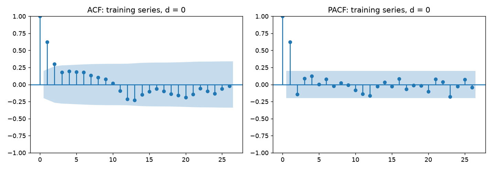
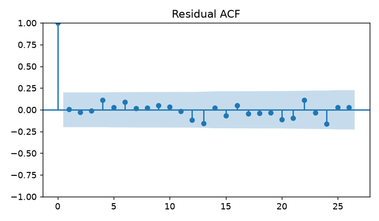
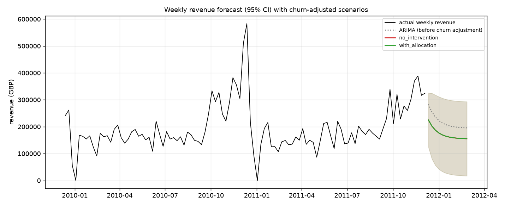

# Step 9: ARIMA on a real revenue series

## Data and its limits

Series: UCI Online Retail II (a UK gift wholesaler), weekly revenue = Quantity x Price, excluding cancellations and non-positive quantities or prices; weeks end on Sunday. 104 weeks, 2009-12-13 to 2011-12-04 (incomplete first and last weeks and December 2011 are dropped); currency GBP. Holdout: the last 8 weeks (2011-10-16 to 2011-12-04); training part: 96 weeks.

Limits that matter for reading the results:

- **Different business from the churn data.** The churn model is trained on bank customers. The forecast is portfolio revenue of a different company; the churn model only supplies the share of revenue at risk (see the scenario section).
- **Two years only.** The series contains two Q4 peaks and two Christmas shutdown weeks (zero sales). The training part contains one full year plus the 2010 peak, and the holdout is the 2011 peak build-up, which a model trained on one earlier peak cannot anticipate unless it uses seasonal information.
- Seasonal ARIMA terms were not fitted: with a 52-week period, two cycles cannot separate seasonality from noise or identify seasonal ARMA terms (rule: at least 3 cycles; the series has 2.0). Seasonality enters only through the seasonal-naive baseline.

## Stationarity (training part)

|   d |    stat |      p |   lags |   crit_5pct |
|----:|--------:|-------:|-------:|------------:|
|   0 | -4.4247 | 0.0003 |      0 |     -2.8925 |

ADF with a constant, lag length by AIC. Chosen d = 0 (smallest d whose p-value is below 0.05). The test rejects a unit root for the level; this means the series reverts to a level after the spikes, not that it has no seasonal pattern.

## ACF / PACF

Approximate 95% band +-0.200 (n = 96). Significant ACF lags: [1, 2, 12, 13]; significant PACF lags: [1, 23]. Cutoff rule (consecutive significant lags from lag 1): PACF suggests p = 1, ACF suggests q = 2. Reading: the PACF has a single strong spike at lag 1 and the ACF decays gradually (positive for the first lags, then crossing zero) instead of cutting off. That is the signature of an AR(1) process, so p = 1 is the suggestion and the ACF cutoff count (q = 2) is not meaningful when the ACF tails off. Significant lags further out (ACF [12, 13], PACF [23]) are isolated, beyond the grid, and are not modelled.

## Order selection (AIC on the training part)

|   p |   d |   q |     aic |     bic |
|----:|----:|----:|--------:|--------:|
|   1 |   0 |   1 | 2405.59 | 2415.84 |
|   2 |   0 |   0 | 2406.02 | 2416.28 |
|   0 |   0 |   2 | 2406.22 | 2416.47 |
|   1 |   0 |   0 | 2406.45 | 2414.14 |
|   3 |   0 |   0 | 2406.59 | 2419.41 |
|   1 |   0 |   2 | 2407.39 | 2420.21 |
|   2 |   0 |   1 | 2407.64 | 2420.46 |
|   3 |   0 |   1 | 2407.72 | 2423.1  |
|   1 |   0 |   3 | 2408.05 | 2423.44 |
|   0 |   0 |   3 | 2408.06 | 2420.88 |
|   2 |   0 |   2 | 2408.76 | 2424.15 |
|   2 |   0 |   3 | 2409.23 | 2427.18 |
|   3 |   0 |   2 | 2409.6  | 2427.55 |
|   3 |   0 |   3 | 2411.13 | 2431.65 |
|   0 |   0 |   1 | 2412.81 | 2420.5  |
|   0 |   0 |   0 | 2796.4  | 2801.53 |

Chosen: ARIMA(1, 0, 1) (lowest AIC). ACF/PACF reading was p = 1, q = 2; AIC agrees: False. The next-best order is only 0.43 AIC units behind, so several low orders are statistically indistinguishable and the choice is not sharp.

## Residual diagnostics

|   lag |   stat |      p |
|------:|-------:|-------:|
|     8 | 2.4047 | 0.879  |
|    16 | 8.0112 | 0.8887 |

Ljung-Box null: no residual autocorrelation (degrees of freedom reduced by p + q). Residuals show no leftover autocorrelation at these lags. This says the ARIMA captures the short-memory structure; it says nothing about the seasonal pattern, which a non-seasonal model cannot capture.

## Baseline comparison

Holdout (8 weeks, one split). Moving-average window chosen on the training part: 8 (candidates scored inside the training part only). MAPE excludes zero-sales weeks.

|                |      MAE |   MAPE % |   1-step abs error |
|:---------------|---------:|---------:|-------------------:|
| arima          | 114173   |    35.26 |           62199.3  |
| naive          |  42339.3 |    14.75 |           91211.2  |
| moving_average |  84865.2 |    25.52 |            5224.31 |
| seasonal_naive |  53018.7 |    18.29 |           98503.3  |

Rolling-origin backtest: 10 expanding-window origins (4 weeks apart, last origin = start of the holdout); the order, d and window are re-selected from data before each origin. Mean over origins:

|                |     MAE |   MAPE % |   1-step MAE |
|:---------------|--------:|---------:|-------------:|
| arima          | 49389   |    25.64 |      39684.8 |
| moving_average | 52936.7 |    28.41 |      39104.3 |
| naive          | 40876.7 |    21.43 |      42705.6 |
| seasonal_naive | 35079.4 |    19.24 |      39602.9 |

Lowest MAE per origin (count of origins won): {'naive': 4, 'seasonal_naive': 4, 'arima': 2}.

**Verdict.** On the holdout ARIMA ranks 4 of 4 by MAE (best: naive); in the rolling backtest it ranks 3 of 4 (best: seasonal_naive). ARIMA beats no baseline on the holdout and moving_average in the rolling backtest. ARIMA does not beat the simplest baselines on this series. The series is dominated by a recurring Q4 peak and a Christmas shutdown that a non-seasonal ARIMA cannot anticipate; the seasonal-naive baseline (same week a year earlier) uses that information directly. One earlier year of history is the binding limit, not the choice of ARIMA order.

## Forecast and scenarios

Final fit on the full series: ARIMA(1, 0, 0), forecasting 12 weeks with 95% intervals (lower bound floored at 0). The weeks ahead include the Christmas shutdown; the model has no way to know that and will over-forecast those weeks.

The two series come from different datasets. ARIMA forecasts portfolio revenue; the churn model estimates the share of that revenue at risk:

- L = sum p_i v_i / sum v_i on the churn **test split** with calibrated probabilities = 0.2066 (1500 customers).
- no_intervention = forecast x (1 - L).
- L' = L - (expected revenue saved by the Step 8 segment-aware, offer-snapped allocation on the same test customers) / sum v_i; with_allocation = forecast x (1 - L'). Here saved = 82,201 of 151,690,446 total customer value, so L' = 0.2060.

Totals over the horizon: no_intervention 2,068,977 GBP, with_allocation 2,070,390 GBP. The allocation lifts the horizon total by 0.07% (the two lines in the figure are almost on top of each other): the Step 8 budget is small next to the revenue at risk, so the mechanism is visible but the effect is small.

Caveats: L is a ratio from a bank dataset applied to a retailer's revenue forecast, so the scenario totals illustrate the mechanism; they are not an estimate for either business. The allocation saving is itself based on assumed response curves (Step 8). Weekly data keep the parquet column name `month`, which holds the week-ending Sunday; `GET /forecast` returns a `freq` field (`W-SUN`).
