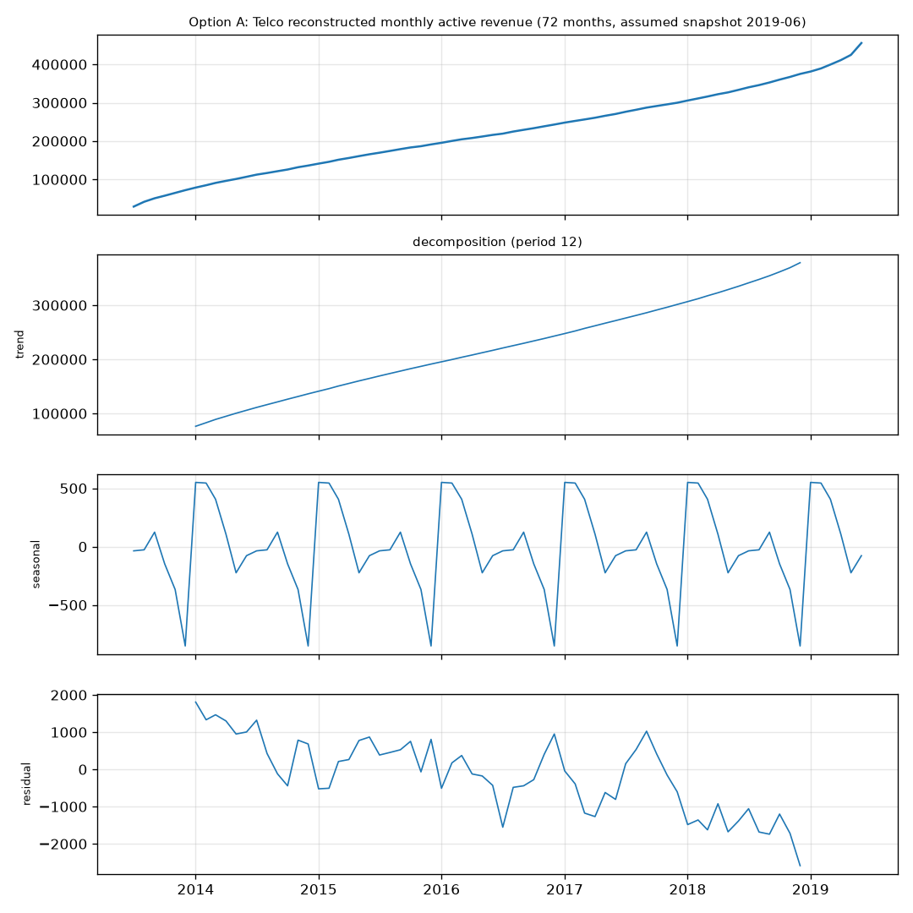
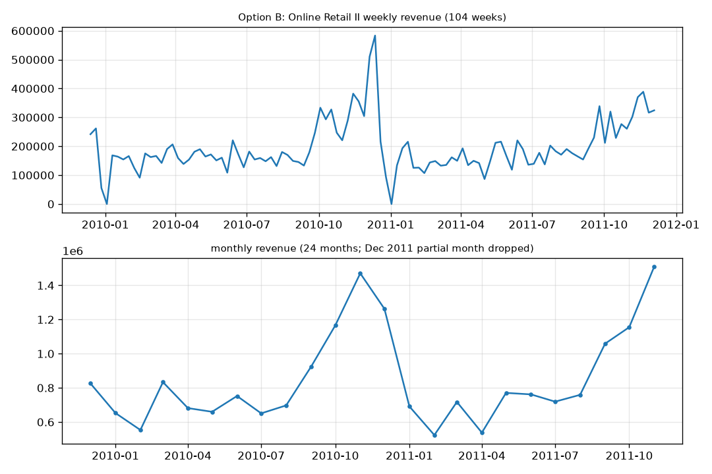
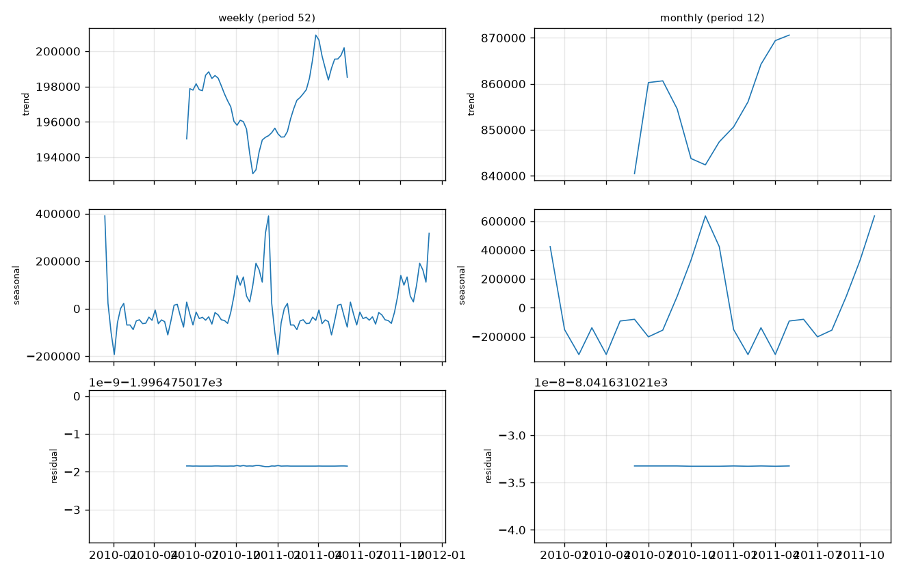

# Step 9.0: choosing a real revenue series for ARIMA

The churn datasets have no timestamps, so the Step 5 revenue history was simulated with an AR(1)
process and ARIMA was then fitted to it. That comparison is circular. This note compares two real
replacements. Both series are built by `src/churn/risk/series.py`; the numbers come from
`scripts/series_choice.py` (saved in `artifacts/series_choice.json`).

## Option A: Telco reconstruction

Monthly active revenue for the 72 months before an assumed snapshot month (2019-06; the file has no
calendar date, so the snapshot month is an assumption). A customer contributes `Monthly Charges` in
each of the last `Tenure Months` months.

| | |
|---|---|
| Points | 72 monthly |
| Range | 29,212 (first month) to 455,661 (last month) |
| Months with a rise vs the month before | 71 of 71 (100%) |
| ADF on the level | statistic -0.40, p = 0.911 (cannot reject a unit root) |
| ADF on the first difference | statistic +4.16, p = 1.000 (still non-stationary) |
| Linear trend | R² = 0.991, p < 1e-70 |
| Seasonality | none: the period-12 component is about ±500 on a 300,000 level, i.e. cohort noise |

**Verdict: not usable.** The series is a monotone ramp by construction. It is the cumulative count of
customers who joined and are still alive at the snapshot, so it measures acquisition history, not
revenue. Reasons it cannot be treated as revenue history:

- *Survivorship bias.* Only customers present in the snapshot quarter are in the file. Customers who
  left earlier are missing, so every earlier month is under-counted and the ramp is steeper than the
  real business was. Only 362 of 7,043 customers are old enough to appear in the first month.
- *Current price.* `Monthly Charges` is today's price applied to every past month.
- Even the first difference is not stationary (ADF p = 1.0), so ARIMA would need d = 2 on a series
  that is smooth by construction. Any "forecast" is an extrapolation of the tenure histogram.

Its one advantage, same customers as the churn model, does not repair these problems.

## Option B: UCI Online Retail II

Downloaded from the UCI static link for dataset 502 (45.6 MB zip containing `online_retail_II.xlsx`,
extracted in an isolated folder and copied to `data/raw/`, which is gitignored). 1,067,371 invoice
lines (two sheets) from 2009-12-01 to 2011-12-09. Revenue = Quantity x Price after excluding
cancellations (Invoice starting with `C`) and non-positive quantities or prices: 1,041,670 lines kept.
Incomplete first and last periods are dropped (the data ends on Friday 2011-12-09, so December 2011
and the last partial week are removed). Empty weeks inside the range are real zero-sales weeks.

| | Weekly (weeks ending Sunday) | Monthly |
|---|---|---|
| Points | 104 (2009-12-13 to 2011-12-04) | 24 (2009-12 to 2011-11) |
| ADF on the level | statistic -4.25, p = 0.0005 | statistic -4.57, p = 0.0001 (9 lags on 24 points; unreliable) |
| ADF on the first difference | statistic -9.25, p < 1e-14 | statistic -2.42, p = 0.135 (unreliable at n = 24) |
| Linear trend | slope +817 per week, p = 0.004, R² = 0.08 | slope +13,997 per month, p = 0.088, R² = 0.13 |
| Zero-sales weeks | 2 (the Christmas shutdown weeks) | n/a |

Trend and seasonality:

- *Trend:* weak. The level is roughly flat for most of the two years with a statistically
  significant but small upward drift (R² 0.08 on weekly data).
- *Seasonality:* one visible pattern, a build-up from September to a peak in November, then collapse
  to zero over the Christmas shutdown, in both 2010 and 2011. The decomposition below reports a
  "seasonal strength" of 1.0 and a residual of about zero. **That number is a degenerate artefact:**
  with exactly two cycles, classical decomposition assigns the repeating shape to the seasonal part by
  construction. Two observed Q4 seasons is the only evidence for seasonality, and it cannot be
  separated from noise statistically.
- *Stationarity:* the weekly level rejects a unit root (p = 0.0005) because the series reverts after
  each spike; this is stationarity around a level plus a recurring Q4 pattern, not a clean
  stationary process. The monthly ADF results are not trustworthy at 24 points.

## Comparison

| | A: Telco reconstruction | B: Online Retail II weekly | B: Online Retail II monthly |
|---|---|---|---|
| Real dated revenue | no (rebuilt from tenure, snapshot date assumed) | yes | yes |
| Points | 72 | 104 | 24 |
| ADF level | p = 0.91 | p = 0.0005 | p = 0.0001 (n too small) |
| Trend | near-perfect ramp | weak | weak |
| Seasonality | none | one Q4 pattern, 2 observations | same, 2 observations |
| Same business as the churn data | yes | no (UK gift wholesaler) | no |
| Enough points for a holdout and several rolling origins | yes but meaningless | yes | no |
| Main bias | survivorship, current price | one-off Christmas shutdown, Q4 spike | too short |

## Recommendation: Option B, weekly

Weekly Online Retail II is the only candidate that is real dated revenue and has enough points
(104) for a holdout, a rolling-origin backtest and an AIC grid. Monthly (24 points) is too short for
any of those. Option A should be dropped.

What to expect, stated in advance so the later result is not judged against a moving target:

- It is a different business from the bank customers used by the churn model. The forecast will be
  framed as portfolio revenue, with the churn model supplying the share of revenue at risk (Phase 9.2).
- An 8-week holdout at the end of the series falls in the Q4 peak (October to early December 2011), and
  the training part contains only one earlier Q4. A non-seasonal ARIMA is unlikely to anticipate the
  rise; a seasonal naive baseline (lag 52) could be hard to beat. If ARIMA does not beat the baselines,
  the Step 9 report will say so.
- Seasonal ARIMA terms are not well supported by two cycles and will only be included if the training
  part justifies them.

Decision needed: confirm Option B (weekly) before Phase 9.1, or choose differently.
