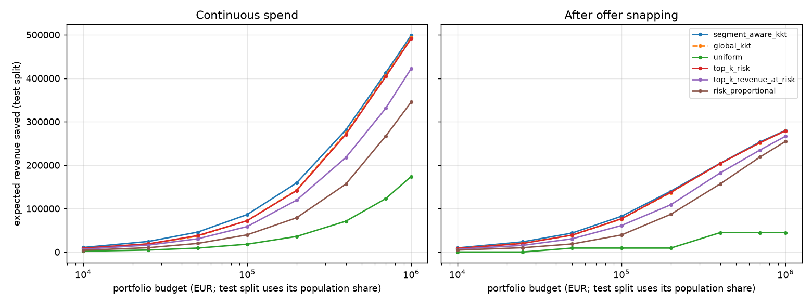
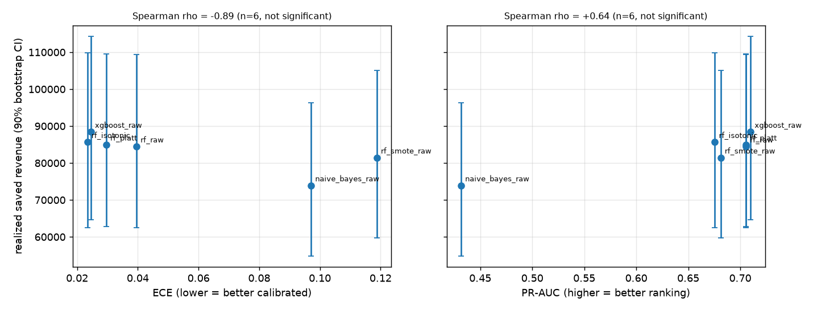
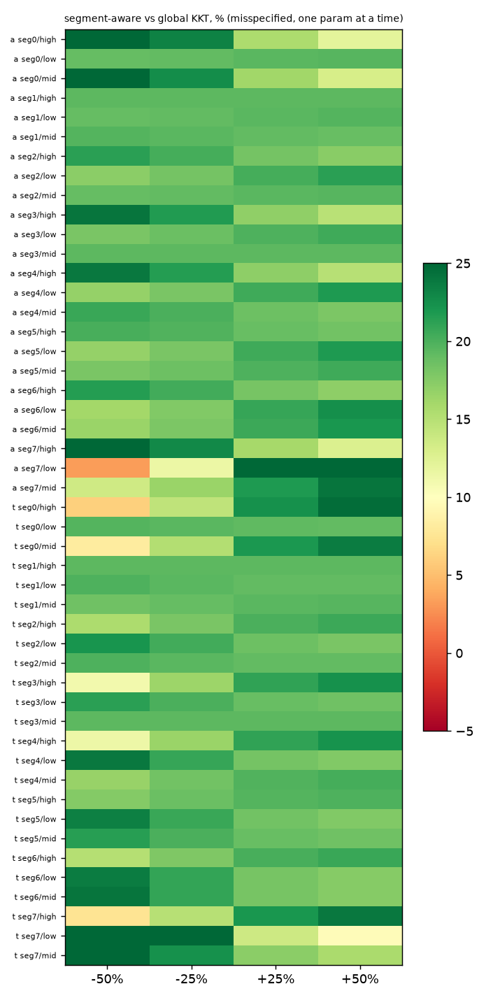

# Allocation report

## Response-curve groups (segment x value tier)

Response model for customer *i* in group *g* = (segment, value tier):

`r_i(x) = p_i · v_i · a_g · (1 − exp(−x / τ_i))`, with `τ_i = t_g · v_i`,
`a_g = a · m_seg · m_tier`, `t_g = t · n_seg · n_tier`.

**These parameters are assumptions.** The dataset has no treatment or uplift data (nobody was
randomly offered anything), so how strongly a group responds to an offer cannot be estimated.
Every number is in `configs/config.yaml` under `allocation.response_curves`.

**Rule (written before looking at which strategy wins, not tuned):**

1. *Segment → a.* Engagement index `e_s` = mean of the across-segment z-scores of the segment's
   train-split mean `IsActiveMember` and mean `NumOfProducts`. `m_seg = clip(1 + 0.15·e_s, 0.5, 1.5)`.
   More engaged segments (active members, more products) are assumed to respond more to offers.
2. *Segment → t.* No evidence that segments differ in how large an offer must be, so `n_seg = 1`
   (slope 0).
3. *Tier → t.* Tier index k = −1, 0, +1 for low, mid, high; `n_tier = 1.25^k`. High-value customers
   need a bigger offer to move. Nothing suggests tiers differ in maximum response, so `m_tier = 1`.
4. Defaults `a = 0.30` (the previous global offer uplift) and `t = 0.05` (the previous global
   `tau_frac`).

Caveat: the GMM segments are only weakly separated on engagement (segment means of
`IsActiveMember` range 0.47–0.56 and of `NumOfProducts` 1.28–1.79), so the segment multipliers
are modest by construction. Since `m_tier = n_seg = 1`, tiers affect only `t_g` and segments only `a_g`.

|   segment_id | value_tier   |   engagement | engagement_class   |   m_seg |   m_tier |   n_seg |   n_tier |    a_g |    t_g |
|-------------:|:-------------|-------------:|:-------------------|--------:|---------:|--------:|---------:|-------:|-------:|
|            0 | low          |      -1.0905 | low                |  0.8364 |        1 |       1 |     0.8  | 0.2509 | 0.04   |
|            0 | mid          |      -1.0905 | low                |  0.8364 |        1 |       1 |     1    | 0.2509 | 0.05   |
|            0 | high         |      -1.0905 | low                |  0.8364 |        1 |       1 |     1.25 | 0.2509 | 0.0625 |
|            1 | low          |       0.7941 | high               |  1.1191 |        1 |       1 |     0.8  | 0.3357 | 0.04   |
|            1 | mid          |       0.7941 | high               |  1.1191 |        1 |       1 |     1    | 0.3357 | 0.05   |
|            1 | high         |       0.7941 | high               |  1.1191 |        1 |       1 |     1.25 | 0.3357 | 0.0625 |
|            2 | low          |       0.3898 | high               |  1.0585 |        1 |       1 |     0.8  | 0.3175 | 0.04   |
|            2 | mid          |       0.3898 | high               |  1.0585 |        1 |       1 |     1    | 0.3175 | 0.05   |
|            2 | high         |       0.3898 | high               |  1.0585 |        1 |       1 |     1.25 | 0.3175 | 0.0625 |
|            3 | low          |      -0.4104 | low                |  0.9384 |        1 |       1 |     0.8  | 0.2815 | 0.04   |
|            3 | mid          |      -0.4104 | low                |  0.9384 |        1 |       1 |     1    | 0.2815 | 0.05   |
|            3 | high         |      -0.4104 | low                |  0.9384 |        1 |       1 |     1.25 | 0.2815 | 0.0625 |
|            4 | low          |      -0.5993 | low                |  0.9101 |        1 |       1 |     0.8  | 0.273  | 0.04   |
|            4 | mid          |      -0.5993 | low                |  0.9101 |        1 |       1 |     1    | 0.273  | 0.05   |
|            4 | high         |      -0.5993 | low                |  0.9101 |        1 |       1 |     1.25 | 0.273  | 0.0625 |
|            5 | low          |       0.3087 | high               |  1.0463 |        1 |       1 |     0.8  | 0.3139 | 0.04   |
|            5 | mid          |       0.3087 | high               |  1.0463 |        1 |       1 |     1    | 0.3139 | 0.05   |
|            5 | high         |       0.3087 | high               |  1.0463 |        1 |       1 |     1.25 | 0.3139 | 0.0625 |
|            6 | low          |       0.4132 | high               |  1.062  |        1 |       1 |     0.8  | 0.3186 | 0.04   |
|            6 | mid          |       0.4132 | high               |  1.062  |        1 |       1 |     1    | 0.3186 | 0.05   |
|            6 | high         |       0.4132 | high               |  1.062  |        1 |       1 |     1.25 | 0.3186 | 0.0625 |
|            7 | low          |       0.1945 | high               |  1.0292 |        1 |       1 |     0.8  | 0.3088 | 0.04   |
|            7 | mid          |       0.1945 | high               |  1.0292 |        1 |       1 |     1    | 0.3088 | 0.05   |
|            7 | high         |       0.1945 | high               |  1.0292 |        1 |       1 |     1.25 | 0.3088 | 0.0625 |

## KKT derivation

**Problem.** Choose spend `x_i` for each customer to maximise expected saved revenue under a budget
and per-customer caps:

`max Σ_i r_i(x_i)`, `r_i(x) = b_i (1 − e^{−x/τ_i})`, `b_i = p_i v_i a_i`,
subject to `Σ_i x_i ≤ B` and `0 ≤ x_i ≤ c` (c = `max_spend_per_customer`).

Each `r_i` is strictly concave (`r_i'' = −(b_i/τ_i²) e^{−x/τ_i} < 0`) and the constraints are
affine, so the problem is convex, Slater holds (x = 0 is strictly feasible when B > 0), and the
KKT conditions are necessary and sufficient for the global optimum.

**Lagrangian.** With multiplier `λ ≥ 0` for the budget and `μ_i ≥ 0`, `ν_i ≥ 0` for the box:

`L = Σ r_i(x_i) − λ(Σ x_i − B) + Σ μ_i x_i − Σ ν_i (x_i − c)`

**Stationarity.** `∂L/∂x_i = (b_i/τ_i) e^{−x_i/τ_i} − λ + μ_i − ν_i = 0`.

**Complementary slackness.** `λ(Σ x_i − B) = 0`, `μ_i x_i = 0`, `ν_i (x_i − c) = 0`.

Three cases per customer:

- *Interior* (`0 < x_i < c`): `μ_i = ν_i = 0`, so `(b_i/τ_i) e^{−x_i/τ_i} = λ`, i.e.
  `x_i = τ_i ln(b_i / (τ_i λ))`. Marginal return equals the common price λ.
- *Lower bound* (`x_i = 0`): `μ_i ≥ 0` gives `b_i/τ_i ≤ λ`: the first euro already returns less
  than λ, so the customer is not worth targeting. Note `b_i/τ_i = p_i a_i / t_g`, independent of v.
- *Upper bound* (`x_i = c`): `ν_i ≥ 0` gives `(b_i/τ_i) e^{−c/τ_i} ≥ λ`: still worth more than λ at the cap.

All three collapse to the closed form `x_i(λ) = clip(τ_i ln(b_i/(τ_i λ)), 0, c)`.

**Finding λ.** Each `x_i(λ)` is non-increasing in λ (ln is increasing, so larger λ lowers the unclipped
value, and clipping preserves monotonicity), continuous, equal to the cap for small enough λ, and equal
to 0 for `λ ≥ max_i b_i/τ_i`. Hence total spend `S(λ) = Σ x_i(λ)` is continuous and monotone
decreasing, so `S(λ) = B` has a solution whenever `B ≤ n·c` (otherwise every customer sits at the cap).
Bisection on λ (in log space) converges to it; we return the iterate on the feasible side so
`Σ x_i ≤ B` holds exactly.

**Cross-check.** A separate dual projected-gradient ascent alternates `x ← clip(x + η(r'(x) − λ), 0, c)`
and `λ ← max(0, λ + η'(Σx − B))`. `run_allocate` asserts its objective agrees with the closed form
within 0.5% (`allocation.dual_check_tolerance`).

## Strategy comparison on the test split (claim 2)

1500 customers, budget 15,000 (= portfolio budget 100,000 x population share 0.15). All strategies are scored with the same segment-aware response model; `global_kkt` solves with one global a and t instead. *Continuous* = solved spend; *snapped* = after offer matching and budget re-balancing. *Realized saved* uses the true churn labels (one realisation, noisy).

| strategy              | spend mode   |   spend |   expected saved |   targeted |   saved per spend |   realized saved (labels) |
|:----------------------|:-------------|--------:|-----------------:|-----------:|------------------:|--------------------------:|
| segment_aware_kkt     | continuous   | 15000   |         86158.4  |         61 |             5.744 |                  88159.7  |
| segment_aware_kkt     | snapped      | 14967.7 |         82201.2  |         79 |             5.492 |                  83946.6  |
| global_kkt            | continuous   | 15000   |         72239.1  |         66 |             4.816 |                  73489    |
| global_kkt            | snapped      | 14821.3 |         75837.4  |         89 |             5.117 |                  78524.1  |
| uniform               | continuous   | 15000   |         17952    |       1500 |             1.197 |                  17814.9  |
| uniform               | snapped      |  7500   |          8997.53 |       1500 |             1.2   |                   8926.38 |
| top_k_risk            | continuous   | 15000   |         71986.6  |         30 |             4.799 |                  71924.7  |
| top_k_risk            | snapped      | 14929.3 |         76561.5  |         84 |             5.128 |                  78571.3  |
| top_k_revenue_at_risk | continuous   | 15000   |         58514    |         30 |             3.901 |                  61770    |
| top_k_revenue_at_risk | snapped      | 14816.7 |         60921.6  |         89 |             4.112 |                  65023.6  |
| risk_proportional     | continuous   | 15000   |         39486.9  |       1332 |             2.632 |                  39779.2  |
| risk_proportional     | snapped      | 14905   |         39173.4  |       1131 |             2.628 |                  39582.7  |

Segment-aware vs global KKT (continuous): 86,158 vs 72,239 expected saved (+19.27%). Realized difference 14,671, 90% bootstrap CI [-8,075, 37,502] over customers.

## Calibration vs ranking on the test split (claim 1)

Each probability source drives `segment_aware_kkt` at the same budget; the allocation is then scored by **realized** saved revenue, sum of y_i v_i a_i (1 - exp(-x_i / tau_i)), using the true churn labels (not any model's probability). Response parameters are the same assumed ones for every source. CIs are 90% bootstrap intervals (1000 resamples of test customers, spends held fixed). `diff_vs_base` is the paired difference against `p_rf_raw`.

| source            |   pr_auc |   brier |    ece |   realized_saved |   ci_lo |    ci_hi |   diff_vs_base |   diff_lo |   diff_hi |   realized_saved_snapped |
|:------------------|---------:|--------:|-------:|-----------------:|--------:|---------:|---------------:|----------:|----------:|-------------------------:|
| p_rf_isotonic     |   0.6756 |  0.1018 | 0.0234 |          85659   | 62436.9 | 109817   |       1194.46  |  -5007.78 |   6718.41 |                  80962.5 |
| p_rf_platt        |   0.7055 |  0.1016 | 0.0296 |          84979.2 | 62732.1 | 109474   |        514.649 |  -6136.6  |   6082.25 |                  82053.8 |
| p_rf_raw          |   0.7055 |  0.1043 | 0.0396 |          84464.5 | 62467.3 | 109440   |          0     |      0    |      0    |                  81243.5 |
| p_rf_smote_raw    |   0.6812 |  0.1227 | 0.1188 |          81456.7 | 59783.5 | 105079   |      -3007.84  | -15735.2  |   9724.88 |                  74696   |
| p_naive_bayes_raw |   0.4316 |  0.1569 | 0.0971 |          73933.6 | 54869.9 |  96358.2 |     -10530.9   | -32380.9  |  12419.9  |                  57336.1 |
| p_xgboost_raw     |   0.7099 |  0.1015 | 0.0245 |          88426.5 | 64709.6 | 114302   |       3961.95  | -11729.4  |  19273.2  |                  81583.1 |

Spearman correlation with realized saved revenue (n = 6; no significance claimed): ECE -0.89, Brier -0.94, PR-AUC +0.64.

**Reading.**
- Paired differences against `p_rf_raw` all have intervals containing zero: True. The data cannot separate the sources on realized savings.
- ECE and Brier correlate with realized saved revenue more strongly than PR-AUC does: True. With six points this is suggestive only, and Brier mixes ranking and calibration, so it cannot isolate calibration.
- The deliberately miscalibrated RF+SMOTE (ECE 0.119 vs 0.040) changes realized savings by -3,008 relative to RF raw (paired CI [-15,735, 9,725]).
- Naive Bayes changes realized savings by -10,531 but also ranks much worse (PR-AUC 0.43 vs 0.71), so its loss cannot be attributed to calibration.
- Why calibration has little room to matter here: when the budget binds, the KKT spend is x_i = tau_i ln(p_i a_i / (t_g lambda)). Multiplying every p_i by a constant is absorbed by lambda, so a pure scale error (Platt or raw vs isotonic of the same ranking) changes nothing; only distortions that change the relative p across customers matter, and those are ranking effects. Calibration would matter more for decisions about *whether* to spend at all (a fixed ROI threshold), which a fixed-budget allocation does not make.

## Sensitivity: +-25% and +-50% on every a_g and t_g (Phase 8.5)

Each of the 24 group parameters of a and of t is varied one at a time (-50, -25, +25, +50%), and all together (a, t, both); 204 scenarios. Two readings:

- *misspecified*: the world is perturbed but every strategy plans with its nominal assumptions (our current beliefs). This is the informative robustness test.
- *resolved*: the segment-aware solver is told the perturbed parameters. It is optimal under its own model, so staying first is nearly automatic; only the margin is informative.

Misspecified: segment-aware is first in **204 of 204** scenarios and loses to global KKT in **0**; its margin over global KKT ranges +3.2% to +41.3% (nominal +19.3%). Resolved: first in 204 of 204, margin +13.0% to +49.1%.

All-together scenarios (segment-aware vs global KKT, relative margin):

| param   |   level |   misspecified_seg_vs_global |   resolved_seg_vs_global | first_misspecified   |
|:--------|--------:|-----------------------------:|-------------------------:|:---------------------|
| a       |   -0.5  |                       0.1927 |                   0.1927 | segment_aware_kkt    |
| t       |   -0.5  |                       0.1354 |                   0.1514 | segment_aware_kkt    |
| a+t     |   -0.5  |                       0.1354 |                   0.1514 | segment_aware_kkt    |
| a       |   -0.25 |                       0.1927 |                   0.1927 | segment_aware_kkt    |
| t       |   -0.25 |                       0.1727 |                   0.1751 | segment_aware_kkt    |
| a+t     |   -0.25 |                       0.1727 |                   0.1751 | segment_aware_kkt    |
| a       |    0.25 |                       0.1927 |                   0.1927 | segment_aware_kkt    |
| t       |    0.25 |                       0.2051 |                   0.2065 | segment_aware_kkt    |
| a+t     |    0.25 |                       0.2051 |                   0.2065 | segment_aware_kkt    |
| a       |    0.5  |                       0.1927 |                   0.1927 | segment_aware_kkt    |
| t       |    0.5  |                       0.2136 |                   0.2179 | segment_aware_kkt    |
| a+t     |    0.5  |                       0.2136 |                   0.2179 | segment_aware_kkt    |

One-at-a-time scenarios aggregated over the 24 groups (misspecified margin, min / mean / max):

| param   |   level |    min |   mean |    max |
|:--------|--------:|-------:|-------:|-------:|
| a       |   -0.5  | 0.0324 | 0.193  | 0.2752 |
| a       |   -0.25 | 0.1141 | 0.1927 | 0.2326 |
| a       |    0.25 | 0.1553 | 0.1927 | 0.2683 |
| a       |    0.5  | 0.1202 | 0.1929 | 0.3411 |
| t       |   -0.5  | 0.0611 | 0.1892 | 0.4129 |
| t       |   -0.25 | 0.1447 | 0.1917 | 0.2762 |
| t       |    0.25 | 0.1367 | 0.1931 | 0.2238 |
| t       |    0.5  | 0.0967 | 0.1934 | 0.2457 |

**Stress test outside the requested grid** (assumed heterogeneity exactly backwards: a_g mirrored around the global a, and/or the tier ratio t_g / t inverted):

| param               |   seg_vs_global | first                 |
|:--------------------|----------------:|:----------------------|
| reverse_a           |          0.0457 | segment_aware_kkt     |
| reverse_t           |         -0.2153 | top_k_revenue_at_risk |
| reverse_a+reverse_t |         -0.3221 | top_k_revenue_at_risk |

Reading: within +-50% perturbations the segment-aware plan keeps its lead because the *direction* of the assumed heterogeneity is unchanged. If the direction itself is wrong (tier effect on t reversed) it falls behind global KKT. The advantage rests on the assumed ordering of segments and tiers, which this data cannot verify.

## Reallocation rounds vs one-shot (6 monthly rounds, 200 seeds)

Simulation on the test split (see `src/churn/allocate/rounds.py` for assumptions): the horizon churn probability is split into per-round hazards; each round solves the incremental KKT problem on the remaining customers with pool / (rounds left); churned and saved customers leave and their unspent share stays in the pool; offer effects depend on cumulative spend and persist. One-shot allocates the same total budget up front.

| | mean saved | 90% interval |
|---|---:|---|
| rounds | 58,030 | [0, 189,333] |
| one-shot | 87,725 | [0, 238,710] |
| paired difference (rounds - one-shot) | -29,695 (SE 7,081) | [-198,394, 124,722] |

Rounds beat one-shot in 35% of seeds. Mean spend: rounds 15,000, one-shot 15,000; the largest total over any run was 15,000.00 against a budget of 15,000.

Reading: in this model rounds do **not** beat a single up-front allocation. Only 1/6 of the budget is available in round 1, so customers are protected later, after some have already churned, while the benefit of re-allocating money away from removed customers is small (only a few percent of customers leave per round). Single-seed outcomes are very noisy (each saved customer is worth ~100k), hence the wide per-seed intervals; the mean difference is 4.2 standard errors from zero. Rounds would pay off if the offer effect expired each round or if risk scores were refreshed with new information, neither of which is modelled.

## Production plan and offer matching (stage 2)

Portfolio budget 100,000 EUR on all customers: 555 targeted, 99,917 spent. Continuous KKT would save 571,057; after snapping to the catalog (re-balanced in 12 rounds, effective stage-1 budget 189,109) it saves 537,606.

|                 |   customers |
|:----------------|------------:|
| service_call    |         222 |
| value_discount  |         197 |
| retention_bonus |         108 |
| fee_waiver      |          26 |
| loyalty_email   |           2 |

## KKT vs dual ascent

- KKT objective (continuous spend): 571,057
- Dual-ascent objective: 570,700 (gap 0.062%)

## Assumptions
- Response curves and offer costs/eligibility are assumptions, not measured uplift.